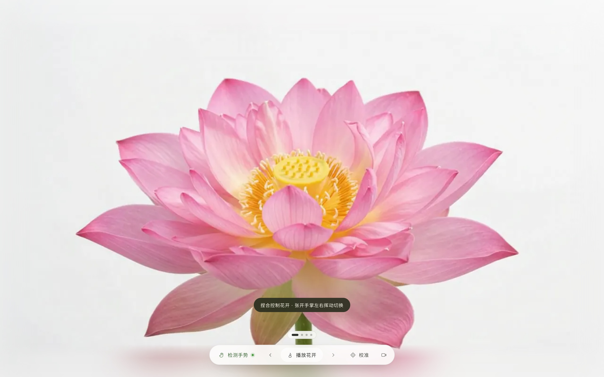

<div align="center">

# GestureBloom · 手势花开

对着摄像头**捏合拇指与食指**，花随手指开合；**张开手掌快速挥过**，在四幅花之间切换。

手部识别完全在浏览器本地运行：不上传视频、不录像、在线打开即用，无需安装。

**在线体验 → <https://gesturebloom.framesecond.uk>**



</div>

---

## 特性

- **无级花开**：拇指与食指的距离映射为 0–100% 的开合度，连续平滑，不是简单的开/关两态。
- **挥手换花**：张开手掌快速横向划过切换场景，慢速移动、抖动、回摆都不会误触发。
- **四幅花**：荷花、白芍药、鸢尾、大丽花，循环切换；切换为 760ms「缩放 + 交叉淡化」过渡。
- **白底无边框**：素材边缘向外延展并羽化溶进白色背景，任何屏幕比例都看不到矩形边界。
- **个体校准**：一次校准记住你的捏合行程，存于浏览器本地。
- **完整降级**：没有摄像头 / 拒绝权限时，方向键、滚轮、底部按钮照样能玩。
- **零构建**：纯 HTML / CSS / JavaScript 静态站点，没有打包步骤、没有 npm 依赖。

---

## 一、本地运行

### 方式 A：Python（推荐，跨平台）

```bash
git clone https://github.com/<你的用户名>/<仓库名>.git
cd GestureBloom
python3 serve.py
```

打开 <http://localhost:8801>，在浏览器弹窗中**允许摄像头**。

- Windows 上命令可能是 `python serve.py` 或 `py -3 serve.py`。
- `serve.py` 只做两件事：固定监听 `127.0.0.1:8801`、给所有响应加 `no-store` 防缓存。不需要任何第三方库。
- 停止服务：在终端按 `Ctrl + C`。

### 方式 B：macOS 双击 `启动.command`

双击仓库里的 `启动.command`，会自动起服务并打开浏览器（带时间戳参数防缓存）。
首次运行若被 Gatekeeper 拦截：右键 → 打开 → 仍要打开。

### 方式 C：没有 Python 时，用任意静态服务器

```bash
npx serve -l 8801 .          # Node.js
npx http-server -p 8801 -c-1 .
php -S localhost:8801        # PHP
```

或在 VS Code 里装 **Live Server** 插件后右键 `index.html` → Open with Live Server。
只要地址是 `http://localhost:<端口>` 或 `https://…` 即可。

### 为什么不能直接双击 `index.html`

| 打开方式 | 能看花 | 能用手势 |
|---|---|---|
| 本地服务器 / 线上 https | ✅ | ✅ |
| 双击 `index.html`（`file://`） | ✅ | ❌ 浏览器在 `file://` 下不开放摄像头 |

摄像头 API 只在**安全上下文**（`localhost` 或 HTTPS）可用，这是浏览器安全策略，与代码无关。

### 浏览器与设备

- 推荐 **Chrome / Edge**（Chromium 内核，已实测）。Safari / Firefox 未逐一验证，需支持 WebP、WebAssembly 与 `getUserMedia`。
- 需要一枚摄像头；光线充足、手完整入框效果最好。
- 手机可玩：iOS / Android 浏览器请在 **HTTPS** 地址下打开（线上地址即可），`http://局域网IP` 不算安全上下文。

---

## 二、怎么玩

### 手势

| 动作 | 效果 |
|---|---|
| 拇指 + 食指 **捏合 ↔ 张开** | 花闭合 ↔ 盛开（连续无级） |
| **张开手掌，快速横向划过** | 切到下一幅；反方向划回上一幅 |
| 挥手过程中 | 自动冻结花开，避免张掌把花一下刷满 |
| 切换后 0.8 秒 | 短暂锁定，新画面从花苞重新开始 |

挥手必须「真的划过去」，以下条件全部满足才触发：

| 条件 | 阈值 |
|---|---|
| 手掌张开 | 260ms 窗口内 ≥70% 的帧 `openness > 1.34` |
| 位移够大 | 窗口内横向位移 > 画面宽度的 20% |
| 速度够快 | > 1.05 画面宽度/秒 |
| 采样够长 | 窗口覆盖 ≥140ms 且 ≥4 帧 |
| 重新武装 | 触发后手停稳 220ms 才接受下一次 |
| 冷却 | 两次切换间隔 ≥650ms |

### 键盘 / 鼠标 / 按钮

| 输入 | 效果 |
|---|---|
| `←` / `→` | 上一幅 / 下一幅 |
| `↑` / `↓` | 花开 +10% / −10% |
| 滚轮 | 控制花开（**仅在手势关闭时**生效，避免与手冲突） |
| 底部 `检测手势` | 手势总开关（绿点 = 开，红点 = 关；关闭即释放摄像头） |
| 底部 `‹` `›` | 切换场景 |
| 底部 `播放花开` | 2.6 秒自动从当前开合度播放到盛开 |
| 底部 `校准` | 张开五指保持 1.5 秒 → 捏合保持 1.5 秒，记住你的行程 |
| 底部相机图标 | 摄像头预览 + 手部骨架 + 实时开合百分比 |
| 底部指示点 | 点击直达对应的那一幅 |

### 深链

地址 hash 可直达指定状态，方便分享与调试：

```
https://gesturebloom.framesecond.uk/#s=2&p=0.6&cam=1
```

`s` = 场景序号（0 起，自动取模），`p` = 开合度 0–1，`cam=1` = 打开摄像头预览面板。

---

## 三、部署到 GitHub Pages

站点是纯静态文件，**仓库根目录即站点**，无需构建。

### 1. 推送代码

```bash
git init
git add .
git commit -m "GestureBloom: 手势花开静态站点"
git branch -M main
git remote add origin git@github.com:<你的用户名>/<仓库名>.git
git push -u origin main
```

`.gitignore` 已排除 `.DS_Store`。**仓库根目录即站点**，部署时不要上传任何历史构建副本（旧的 `dist/` 已删除）。

### 2. 开启 Pages

仓库 → **Settings → Pages**：

- *Build and deployment* → Source 选 **Deploy from a branch**
- Branch 选 **main**，目录选 **/ (root)** → Save

约一分钟后访问 `https://<你的用户名>.github.io/<仓库名>/`。
所有资源路径均为相对路径，**项目子路径下已验证可正常运行**。免费账户需仓库为 public。

### 3. 绑定自定义域名 `gesturebloom.framesecond.uk`

1. 仓库根目录已包含 `CNAME` 文件（内容即域名）；也可在 **Settings → Pages → Custom domain** 填写 `gesturebloom.framesecond.uk` 并 Save，二者等效。
2. 到你的 DNS 服务商添加一条记录：

   | 记录类型 | 主机记录 | 记录值 |
   |---|---|---|
   | `CNAME` | `gesturebloom` | `<你的用户名>.github.io` |

3. 回到 Pages 设置页等待 DNS 校验通过，然后勾选 **Enforce HTTPS**（证书签发可能需要几分钟到几小时）。
4. 完成后 `https://gesturebloom.framesecond.uk` 即为正式地址，原 `github.io` 地址会自动跳转到它。

之后每次 `git push`，GitHub 会自动重新发布，无需其它操作。

---

## 四、项目结构

```
GestureBloom/
├── index.html            页面骨架：canvas + 指示点 + 底部控制 + 摄像头预览
├── styles.css            白底、磨砂胶囊按钮、羽化遮罩、响应式
├── js/
│   ├── main.js           启动流程、按钮、键盘/滚轮降级、深链
│   ├── gesture.js        MediaPipe HandLandmarker + 捏合/挥手识别 + 校准 + 骨架
│   └── stage.js          多场景帧序列 + 切换过渡 + 背景边缘延展
├── assets/frames/
│   ├── 01-lotus/         0001–0080.webp + manifest.json
│   ├── 02-peony/
│   ├── 03-iris/
│   └── 04-dahlia/
├── assets/mediapipe/     本地化的手势识别运行时（≈17 MB，见第九节）
│   ├── vision_bundle.js
│   ├── hand_landmarker.task
│   └── wasm/
├── assets/fonts/
│   └── inter-latin.woff2 自托管 Inter 拉丁子集（48 KB，替代 Google Fonts）
├── serve.py              本地预览服务器（no-cache，127.0.0.1:8801）
├── 启动.command           macOS 双击启动
├── CNAME                 GitHub Pages 自定义域名
├── .nojekyll             关闭 Jekyll 处理
└── docs/preview.jpg      README 预览图
```

每个场景目录里的 `manifest.json` 描述帧数与尺寸：

```json
{ "count": 80, "ext": "webp", "pad": 4, "width": 1280, "height": 720 }
```

四幅花各 80 帧（1280×720 WebP），合计约 6.7 MB：荷花 1.8 MB、白芍药 2.0 MB、鸢尾 1.3 MB、大丽花 1.6 MB。

---

## 五、工作原理

- **帧序列舞台**（`js/stage.js`）：每幅花是一段 80 帧的 WebP 序列（源视频 1280×720 / 10s / 24fps，抽成 8fps）。开合度 0–1 映射到帧序号，按需加载并保留 16 帧缓存，向前后各预取 5 帧。
- **手势识别**（`js/gesture.js`）：MediaPipe HandLandmarker 在浏览器内做 21 关键点推理。三个关键处理：用手掌尺度归一化消掉手远近的影响；一阶平滑 + 死区消抖；每只手各自校准 MIN/MAX 消掉个体差异。挥手是一个带冷却与重新武装的状态机。
- **白底无边框**：背景 canvas 把画面四条边与四角向外拉伸（clamp-to-edge）再整体模糊，画面本身四边用 CSS mask 羽化，因此任何比例下接缝都不可见。
- **切换过渡**：旧场景 `opacity 1→0 / scale 1→1.06`，新场景 `opacity 0→1 / scale 1.06→1`，760ms `easeInOutCubic`，背景同步交叉淡化。两侧 scale 均 ≥1，放大时不露底。

---

## 六、自定义

### 加一幅花

1. 视频拆帧放入 `assets/frames/<id>/`（命名 `0001.webp` 起），写 `manifest.json`（`count` 填实际产出的帧数）：

   ```bash
   mkdir -p assets/frames/05-camellia
   ffmpeg -i input.mp4 -vf "fps=8,scale=1280:-2" -quality 78 assets/frames/05-camellia/%04d.webp
   ```

   ```json
   { "count": 80, "ext": "webp", "pad": 4, "width": 1280, "height": 720 }
   ```

2. 在 `js/stage.js` 顶部 `SCENES` 数组加一行：

   ```js
   { id: '05-camellia', base: 'assets/frames/05-camellia' },
   ```

指示点自动多一个，挥手顺序按数组循环。

### 调手势灵敏度

`js/gesture.js` 顶部：太灵敏（没挥手也切）就调大 `SWIPE_DIST` / `SWIPE_VELOCITY`；挥了没反应就调小。

```js
const SWIPE_OPEN = 1.34;     // 张掌阈值
const SWIPE_DIST = 0.20;     // 位移阈值（占画面宽度）
const SWIPE_VELOCITY = 1.05; // 速度阈值（画面宽度/秒）
const SWIPE_COOLDOWN = 650;  // 两次切换最小间隔 ms
const SWIPE_REARM_MS = 220;  // 触发后停稳多久才接受下一次 ms
```

### 其它常用参数

- 过渡时长：`js/stage.js` 的 `TRANS_MS`（默认 760）。
- 自动播放时长：`js/main.js` 中 `dur = 2600`。
- 模型与 WASM 地址：`js/gesture.js` 的 `LOCAL_BASE` / `WASM_PATH` / `MODEL_URL`。默认指向本地 `assets/mediapipe/`，取不到时自动回退 CDN 常量（`CDN_WASM_PATH` / `CDN_MODEL_URL`）。

---

## 七、常见问题

| 现象 | 原因与处理 |
|---|---|
| 打开一片白 / 提示素材没加载 | 用了 `file://` 或旧缓存。改用本地服务器或线上地址；`serve.py` 已禁缓存，必要时 `Cmd/Ctrl + Shift + R` 强刷 |
| 摄像头黑屏或提示不可用 | 没给权限，或地址不是 `localhost` / HTTPS。页面会自动降级为键盘 / 滚轮 / 按钮 |
| 挥手没反应 | 要五指完全张开 + 一次性快速划过（横移 >20% 画面宽、用时 <0.2s）；或调小 `SWIPE_DIST` / `SWIPE_VELOCITY` |
| 挥完手画面又切回去 | 触发后需停稳 220ms 才接受下一次；仍出现就把 `SWIPE_REARM_MS` 调到 300 |
| 手在画面里但没反应 | 光线太暗或手出框；打开相机图标看骨架是否画出 |
| 一直停在花苞 | 手部模型没下载成功（CDN 不可达）。按上文把模型放本地 |
| 校准提示失败 | 校准时手要一直在画面里：先张开五指 1.5 秒，再捏合 1.5 秒 |
| 手机上打不开摄像头 | 必须 HTTPS。用线上域名地址，不要用 `http://局域网IP` |

---

## 八、隐私

- 摄像头画面只喂给浏览器内的 MediaPipe 模型，**任何视频帧都不离开你的设备**。
- 不录像、不上传、无分析脚本、无 Cookie。
- `localStorage` 仅存两个校准数值（`flora.pinchMin` / `flora.pinchMax`）。
- 点 `检测手势` 关闭即停止摄像头轨道，关闭标签页同样会释放摄像头。

---

## 九、依赖与许可

| 依赖 | 用途 | 许可 |
|---|---|---|
| [MediaPipe Tasks Vision](https://github.com/google-ai-edge/mediapipe) 0.10.14（**已本地化**至 `assets/mediapipe/`） | 浏览器端手部关键点推理 | Apache-2.0 |
| Hand Landmarker 模型（**已本地化**至 `assets/mediapipe/hand_landmarker.task`） | 21 关键点手部模型 | Apache-2.0 |
| Inter（**已本地化**至 `assets/fonts/`，拉丁子集 48 KB） | 界面西文字体 | SIL OFL |
| PingFang SC / 微软雅黑等系统字体 | 中文界面文字（不再加载 1 MB+ 的中文字体包） | 随系统 |

花开序列帧素材版权归项目作者所有，转载 / 商用前请先联系作者确认。代码部分未附开源许可证，默认保留所有权利。

### 本地化的 MediaPipe 资源

手部识别运行时（≈17 MB）已放进仓库，不再依赖境外 CDN：

```
assets/mediapipe/
├── vision_bundle.js          134 KB  MediaPipe Tasks Vision 的 ESM 包
├── hand_landmarker.task      7.4 MB  21 关键点手部模型
└── wasm/
    ├── vision_wasm_internal.js / .wasm           SIMD 版
    └── vision_wasm_nosimd_internal.js / .wasm     无 SIMD 兜底
```

`js/gesture.js` 的地址决策顺序是**本地优先**：先用 `HEAD` 探测本地文件，取不到才回退 CDN。因此断网、googleapis 不可达、或 CDN 被拦截时，手势功能依然可用。

> 实测资源就绪耗时：本地 **0.03 s** vs 境外 CDN **6.4 s**（同一台机器、并发下载）。线上因为走自家 CDN（同一网络）、无跨境链路，收益比本地更明显；首次访问后浏览器还会缓存，第二次几乎瞬时。

更新依赖版本时可这样替换（注意同步改 `js/gesture.js` 顶部的 `LOCAL_BASE` 与 CDN 常量）：

```bash
VER=0.10.14
BASE=https://cdn.jsdelivr.net/npm/@mediapipe/tasks-vision@$VER
curl -sL -o assets/mediapipe/vision_bundle.js "$BASE/vision_bundle.mjs"
for f in vision_wasm_internal vision_wasm_nosimd_internal; do
  curl -sL -o assets/mediapipe/wasm/$f.js   "$BASE/wasm/$f.js"
  curl -sL -o assets/mediapipe/wasm/$f.wasm "$BASE/wasm/$f.wasm"
done
curl -sL -o assets/mediapipe/hand_landmarker.task \
  https://storage.googleapis.com/mediapipe-models/hand_landmarker/hand_landmarker/float16/1/hand_landmarker.task
```

> ⚠️ 路径由 `new URL('assets/mediapipe', document.baseURI)` 在运行时算出，因此根域名部署（`example.com/`）和子路径部署（`xxx.github.io/Repo/`）都能正常工作。不要改回写死的 `'/assets/mediapipe'`——那样在子路径下会 404；而纯相对路径 `'assets/...'` 也不行，动态 `import()` 会把它当裸模块名，报 `Failed to resolve module specifier`。

---

## 十、启动时序

摄像头与识别模型是两条**并行**链路，互不阻塞：

| 阶段 | 说明 |
|---|---|
| ① 权限 + 出画面 | 立即请求 `getUserMedia()`，预览面板自动展开 |
| ② 素材加载 | **只加载当前可见的那一幅花**（10 个帧请求），其余三幅在模型就绪后补 |
| ③ 模型下载 | WASM 与 7.9 MB 模型**并行**下载，都就绪后才启动推理 |

因此点完「允许」就能立刻看到自己的画面，不必等模型下载完（首版会等约 20 s）。

模型改用 `modelAssetBuffer` 传字节而非 `modelAssetPath` 传路径，就是为了让它能和 WASM 初始化并行——旧写法要等 WASM 初始化完才开始下模型，两段串行。

预览面板顶部的状态条会实时反映进度：

| 状态 | 含义 |
|---|---|
| 正在开启摄像头… | 等待浏览器权限弹窗 |
| 正在加载手势模型… | 摄像头已出画面，识别模型还在下载 |
| 手势已就绪 | 可捏合控制花开、挥掌切换 |
| 摄像头不可用 | 权限被拒或没有摄像头，已降级为键盘 / 滚轮 / 按钮 |

### 首屏与网络请求

优化后启动阶段的关键请求（实测）：

| 项 | 数量 |
|---|---|
| 首屏帧素材 | **10 个**（旧版 40 个 / 459 KB） |
| MediaPipe 资源 | 4 个（bundle、wasm js、wasm、模型） |
| 字体 | 1 个（48 KB，同域） |
| 外部域名请求 | **0**（仅本地资源缺失时才回退 CDN） |

几个刻意的取舍：

- **不引 Google Fonts**：`<head>` 里的外部样式表是渲染阻塞的，网络被墙时会一直白屏等超时。改为自托管 Inter 拉丁子集，中文走系统字体。
- **场景懒加载**：`stage.load()` 只等当前场景的首帧；其余三幅由 `warmRest()` 在模型就绪后逐个补齐，切换时若还没加载会先拉首帧再过渡。
- **不做每帧重绘的优化**：骨架 canvas 每帧重置尺寸实测仅 0.002 ms，背景重绘约 1.8 ms/帧，都在预算内，没有为它们增加复杂度。
